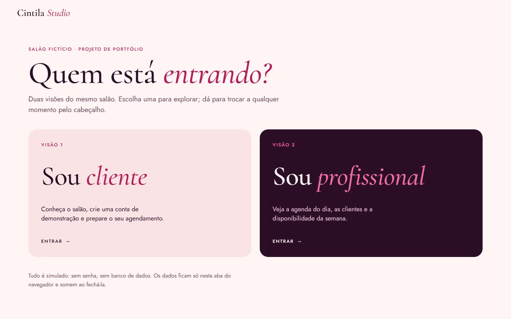

<div align="center">

# Cintila Studio

**A beauty salon website with a working booking flow.**
A client view and a staff view, all running in the browser.

[](https://beauty-salon-chi-mauve.vercel.app/)




</div>

> **Portfolio project.** The salon is fictional. Prices, staff, reviews and bookings are invented, and nothing is sent to a server.

## Highlights

- **Four-step booking wizard:** service, stylist, date and time, then details. Each step is validated before the next.
- **Confirmation** with a simulated email and an add-to-calendar file.
- **Client area** to see the bookings made in the browser.
- **Professional view** at `/profissional`, with sample appointments plus the bookings made on the site.
- **Services, staff, gallery, reviews, hours and map**, plus a validated (simulated) contact form.
- **Cinematic blush-and-plum design** with smooth scroll and GSAP motion.
- **Responsive** from phone to desktop.

## How it works

There is no backend and no database. Bookings are stored in the browser (`localStorage` / `sessionStorage`) so the whole flow can be tried end to end without an account or a server.

## Tech stack

| Area | Choice |
|---|---|
| Framework | Astro 7, static output |
| Language | TypeScript, with small client-side scripts only where needed |
| Motion | GSAP, Lenis |
| Map | Leaflet |
| Fonts | Cormorant Variable + Jost Variable (self-hosted via Fontsource) |

## Getting started

```bash
npm install
npm run dev        # http://localhost:4321
```

| Command | What it does |
|---|---|
| `npm run dev` | Start the dev server |
| `npm run dev:lan` | Dev server reachable from your phone on the same network |
| `npm run build` | Build the static site into `dist/` |
| `npm run preview` | Preview the production build |
| `npm run verify` | Type-check with `astro check`, then build |

## Project structure

```
src/
  pages/      index, agendar (booking), conta, entrar, profissional
  scripts/    booking, session, motion and page scripts
  data/       Salon services, staff and status data
  components/ layouts/ styles/
```

The design system is recorded in [`DESIGN.md`](DESIGN.md) and the scope in [`BRIEF.md`](BRIEF.md). The site is in Brazilian Portuguese.

## Author

Built by **Eduardo Sousa**, web developer in Belo Horizonte, Brazil.

[Portfolio](https://oeduardosousa.com) · [LinkedIn](https://www.linkedin.com/in/eduardo-sousa-528b77334) · [GitHub](https://github.com/oeduardosousa)
